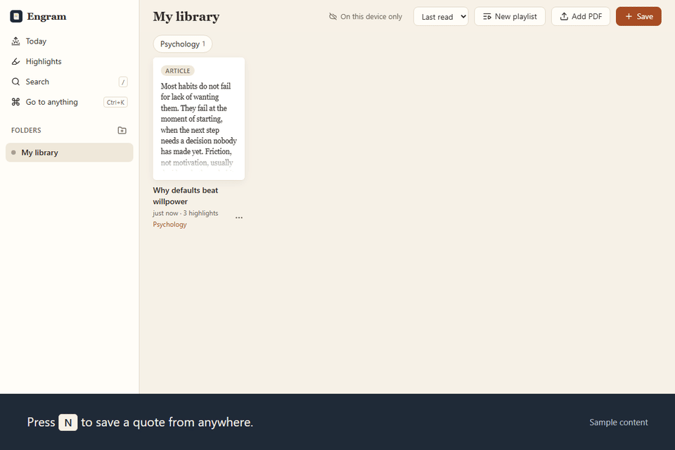

# Engram

[](https://github.com/VedantAndhale/engram/actions/workflows/ci.yml)

A second brain that lives in your own GitHub account.

**Try it:** [engram.vedant.me](https://engram.vedant.me/)



Engram is a web app for reading and keeping what matters: PDFs, articles, posts, links, quotes and
your own notes. Everything you keep is a Markdown file, with your highlights and your own words about
it. Each folder syncs to a private GitHub repository in your account, so your library is on every
device, and it stays readable as plain Markdown without Engram.

Engram reads with you. Select a passage in a saved article and a small language model, running in your
browser on your own device, answers in a note beside it: explain it, define it, put it more simply, or
argue the other side. Nothing you read is sent to an AI service, and Engram's server makes no AI calls.

Engram is also a memory for AI agents. Connect one through MCP and it can search your library, read
what you saved and suggest additions, which you accept or dismiss.

## Features

**Save**

- Press `N`, or paste anywhere, to save a link, a quote or a note.
- **Import** brings highlights from a Kindle `My Clippings.txt` or a Readwise CSV export. Each book is one
  item, and importing the same file again adds only what is new. Nothing is written until you press Import.
- A link like `#/save?url=…&text=…` opens the save box filled in. It never saves by itself.
- **Feeds** (in Setup): add RSS or Atom feeds, and new entries arrive in your Inbox. A scheduled GitHub
  Action in your own folder repository fetches them every six hours. You copy its workflow file into the
  repository once; it uses your own free Actions minutes.
- The **Save to Engram** bookmark keeps a page's formatted text and your selection. Allow pop-ups for
  the page when you use it. Some sites with strict security settings block bookmarks; paste the link
  instead.
- On Android, share to Engram from the share sheet. On iPhone, copy the link, open Engram and paste it
  under Save.
- A link saved without its text is fetched once through Engram's server, which keeps nothing. Only the
  page's address is sent.

**Read**

- Articles open in a reading view. Turn on the highlighter to mark text, use A− and A+ to change the
  size, and tap a highlight to change its colour, add a note or delete it.
- PDFs use pdf.js, with zoom, and your place is remembered per document. Keys: `V` select, `H`
  highlight, `D` pen, `E` eraser, `N` notes, `/` find.
- On a phone or tablet, pick the highlighter or pen. One finger marks, two fingers scroll.
- Export a PDF's highlights and notes as a Markdown file.

**Understand, on your device**

- Select text in a saved article to **Explain**, **Define** (for a word or short phrase), **Simplify** or
  hear the **Counterpoint**, or just start typing a question about the passage. The answer appears as a
  note beside it, with the words it is about marked in the text. On a narrow window the note sits under
  the paragraph instead.
- A bar at the foot of the article asks about the whole thing, and **Summarize** gives the gist. Each
  note keeps its own thread, so you can ask follow-ups inside it.
- Answers cite the paragraphs they used as `¶7`. Point at one to preview that paragraph; click to go to
  it. A PDF's answers cite its pages.
- The model is Gemma 4 E2B, run in your browser with WebGPU. The first question offers to download it,
  once: about 2 GB, from Hugging Face. Your question waits and is answered when the download ends. After
  that it works offline. **Delete model** is in every note and in the command palette, and frees the space.
- It needs a browser with WebGPU (a recent Chrome or Edge on a computer with a graphics card). Without
  it, the rest of Engram works as before.
- It is a small model and it can be wrong. Every note shows the passage it was given, and says so when it
  only read part of a long text. Check anything that matters against the article.

**Write**

- Notes are Markdown with a live preview. Type `/` for blocks, `[[Title]]` to link an item,
  `[[Title#^ref]]` or `![[Title#^ref]]` to link or embed a highlight, and `$…$` or `$$…$$` for math.
- Each item shows what links to it.
- Drag a block to move it, and fold headings and lists.

**Review**

- Today brings your highlights back on a spacing schedule: after 1, 3, 7, 16, 35 and 90 days.
  "Still clear" spaces them further; "Hazy" brings one back tomorrow.
- Today also has a page for today's note, and an optional daily reminder that adds a repeating
  calendar event (an `.ics` file, or Google Calendar).
- Pick the topics you are growing in, and Today shows your progress in each.

**Find**

- Search covers pages, highlights, notes and saved text, in every folder.
- `Ctrl+K` goes to anything. Press `?` for every keyboard shortcut.

**Connect an AI agent**

- Engram has a hosted MCP server. An agent can search your library, including the start of the text
  saved from articles (shown as untrusted), read items and highlights, and
  quiz you on highlights due for review.
- Agents can also suggest a link or some text to save, or lines for an item's notes. Suggestions wait
  under **From your agents** on Today until you accept or dismiss them.
- Saved web text comes back marked as untrusted, so a page you saved cannot instruct your agent.
- Setup and the tool list: [mcp/README.md](mcp/README.md).

**Folders and sync**

- Each folder is a private GitHub repository. Keep as many folders as you like.
- Works offline. Install Engram as an app (PWA), and your data is kept in IndexedDB. A PDF that the
  browser has cleared from its cache needs a connection to open again.
- Light, sepia and dark themes, and a layout that works from phones to wide desktops.

## Your data

| Where | What |
| --- | --- |
| Your browser (IndexedDB) | Items, PDFs, highlights and notes, reading positions, uploads waiting to sync, agent suggestions, the search text |
| Your GitHub account, one private repository per folder | Items as Markdown, PDFs, highlights, reading positions, the folder's search index, and agent suggestions waiting in `inbox/` |
| Your browser's cache storage | The AI model (about 2 GB), only if you chose to download it. It is not synced and not in your repositories |
| Engram's server | Nothing of yours is kept. It exchanges GitHub's sign-in code for a token, answers MCP requests using your own GitHub access, fetches pages for links you save, writes agent suggestions into your repository's `inbox/`, and, on sign-in, records your primary GitHub email, login and name in the Airtable table its owner configures |

**The AI model.** The model file comes straight from Hugging Face to your browser, and is checked
against its exact size before it is kept. Your questions, the text you read and the answers stay on your
device: AI notes live in memory and are gone when you reload the page. Deleting the model removes the file
and clears the notes it wrote. To use an agent of your own instead, connect it through MCP.

**Page views.** The hosted site counts page views with [GoatCounter](https://www.goatcounter.com/). It
counts the screen you open (today, library, item, search), never folder or item IDs, page or item
titles, or shared text, and loads no GoatCounter script. Self-hosted
copies count nothing unless you set `VITE_GOATCOUNTER` to your own GoatCounter code.

**Signing in.** Engram asks GitHub for `repo` access, which covers every private repository your GitHub
account has, not only Engram's folders. It also asks for your email address, which the hosted site
keeps in a sign-up list its owner can see (see the server setup in [mcp/README.md](mcp/README.md)). Your token is kept in this browser and sent only to
`api.github.com`, and to Engram's server when you **Disconnect**, which revokes that token at GitHub (other
devices and agents stay connected). Agents' access lasts 30 days, then they sign in again. To cut off
everything at once, revoke Engram under GitHub → Settings → Applications. The app is served with a strict
Content-Security-Policy: scripts only from Engram itself and YouTube's player.

**Limits to plan around.** GitHub repositories should stay under about 5 GB, with a 100 MB limit per
file and a rate limit on API requests, so large PDF or video libraries need care. The iPhone has no
share sheet for Engram yet. The on-device model needs about 2 GB of free space, can take minutes to load the
first time after a restart, and runs one answer at a time.

## Run it yourself

Needs Node 20.19+ or 22.12+.

```bash
npm install
npm run dev
```

Open http://localhost:5173. Reading, saving and search work without an account. To sync, or to connect
an agent, you also need the server and a GitHub OAuth App. See [mcp/README.md](mcp/README.md).

```bash
npm run build
```

The build in `dist/` is a static site with relative paths and hash routing. Sign-in and MCP need the
function in `api/`, so deploy on Vercel at a domain root.

### Deploy on Vercel

Import the repository in Vercel. It detects Vite: build command `npm run build`, output directory
`dist`, and it serves `api/mcp.ts` as a function. Set these environment variables, then redeploy:

- `GITHUB_CLIENT_ID` and `GITHUB_CLIENT_SECRET`, from your GitHub OAuth App
- `MCP_SECRET`, at least 32 random characters. Changing it signs every client out.
- `PUBLIC_URL` (optional), if the function should use a public address instead of the one a request
  arrived on

Full steps, including the OAuth App's callback URL, are in [mcp/README.md](mcp/README.md).

If you host Engram yourself, your host keeps its own request logs.

## Tech

React 19, TypeScript, Vite, pdf.js, Dexie (IndexedDB), MiniSearch, Zustand, CodeMirror 6, KaTeX,
Mozilla Readability, perfect-freehand, the MCP TypeScript SDK, and, for on-device AI, LiteRT-LM running
Gemma 4 E2B on WebGPU, with Motion for small movements.

## Status and roadmap

Engram is early software. [ROADMAP.md](ROADMAP.md) lists what is planned and what Engram deliberately
will not do.

## Contributing

Bug reports and ideas are welcome as GitHub issues. Please describe the steps you took and the device
and browser you used, and leave out any private highlights, notes or repository links.

## License

[AGPL-3.0](LICENSE). You can use, change and self-host Engram freely. If you run a modified version
as a service for others, you must publish your changes under the same license.
